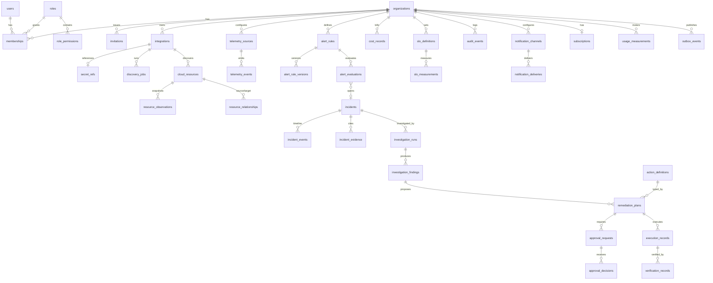
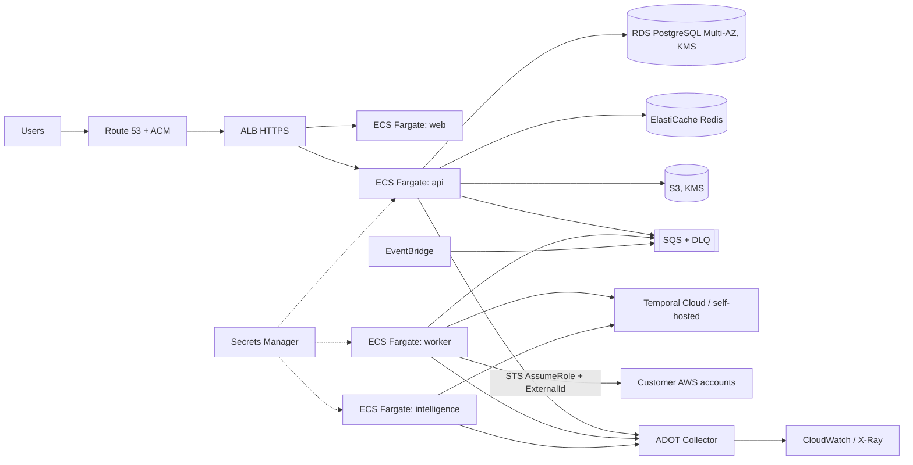

# NEXUS — Architecture & Implementation Plan

## 0. Environment Inspection (2026-10-19)

| Item | Result |
|---|---|
| Workspace `NEKUS/` | Empty — greenfield |
| Node / npm | v24.19.0 / 11.17.0 (corepack 0.35 → pnpm available) |
| Python | 3.13.14 (`py` launcher broken; use `python`) |
| Docker CLI | 29.6.2 — **daemon did not respond** to `docker info` |
| Git | 2.52 |
| Terraform, uv, AWS CLI | **Not installed** |
| **Disk C:** | **0.25 GB free** (npm cache alone = 2.89 GB) |

> [!CAUTION]
> **Blocker:** `npm view` failed with `ENOSPC`. Stage 1 needs roughly **6–8 GB** (pnpm store ≈ 1.5 GB, Python venv ≈ 0.5 GB, local service images ≈ 2 GB, app image builds ≈ 2 GB). **15 GB free is recommended.**

---

## 1. Architecture Summary

A **modular monolith plus workers**, not a microservice sprawl:

- **`apps/web`** — Next.js (App Router) console. It is a pure client of the API; it holds no business data.
- **`apps/api`** — NestJS REST API (`/v1`). It owns identity, tenancy, all domain modules, the OpenAPI spec and the transactional outbox.
- **`apps/worker`** — Node worker (same codebase as the API domain packages). It runs the Temporal TypeScript worker (discovery, reconciliation, approvals, remediation, verification, notifications, health checks), the outbox relay and SQS consumers (telemetry normalisation, alert evaluation).
- **`services/intelligence`** — Python FastAPI service plus a Temporal Python worker on the `nexus-intelligence` task queue. It covers anomaly detection, investigation agents, model-provider adapters and retrieval.
- **Data stores:**
  - PostgreSQL 16 is the system of record, with row-level security (RLS) and time-partitioned telemetry tables.
  - Redis handles rate limits, short-lived caches and WebSocket fan-out.
  - S3 holds large artifacts and raw payloads.
- **Messaging:** outbox → SQS (local: ElasticMQ, which speaks the SQS API) and EventBridge for provider events. Temporal handles durable workflows.
- **Observability:** OpenTelemetry SDKs in every process → OTel Collector → CloudWatch/X-Ray (AWS) or Grafana LGTM (local).

### Key Architectural Decisions (ADRs to be written in Stage 1)

| # | Decision | Rationale |
|---|---|---|
| ADR-001 | pnpm workspaces monorepo plus a Python sub-project managed by uv | Shared contracts, a single CI, reproducible lockfiles |
| ADR-002 | Modular monolith (API) plus separately scalable workers | The spec asks for modular boundaries without premature microservices |
| ADR-003 | **Drizzle ORM** with hand-reviewed SQL migrations | Easy `SET LOCAL app.tenant_id` per transaction for RLS; migrations stay plain SQL |
| ADR-004 | **Better Auth** (self-hosted, Postgres-backed) mounted in NestJS | Maintained library with sessions, email verification, password reset, TOTP MFA and session revocation. Avoids an AWS dependency for local development. OIDC/SAML can be added later. |
| ADR-005 | **Temporal** (local: dev server in Docker; production: Temporal Cloud *or* self-hosted on ECS — decided before Stage 6) | Durable approval waits, crash recovery, retries |
| ADR-006 | Customer telemetry stored in **Postgres native partitions** first; ClickHouse only once measured volume justifies it | Spec rule: add infrastructure only for demonstrated needs |
| ADR-007 | OpenAPI generated from NestJS (`@nestjs/swagger` + Zod) → typed client via `@hey-api/openapi-ts` | Single source of truth for contracts |
| ADR-008 | Model providers behind a Python `ModelProvider` protocol (Amazon Bedrock, Anthropic, OpenAI adapters) | Swappable, credentials stay server-side |
| ADR-009 | ElasticMQ for local SQS (LocalStack community now requires an auth token) | Free, SQS-wire-compatible |

---

## 2. Proposed Directory Tree

```text
nexus/
├── apps/
│   ├── web/                      # Next.js + Tailwind + shadcn/ui + TanStack Query + React Flow
│   │   ├── src/app/(auth)/       # sign-in, recovery, verify
│   │   ├── src/app/(console)/[orgSlug]/...  # 25 console pages
│   │   ├── src/components/ui/    # shadcn primitives
│   │   ├── src/lib/api/          # generated client wrapper, query keys
│   │   └── e2e/                  # Playwright
│   ├── api/                      # NestJS
│   │   └── src/
│   │       ├── main.ts, app.module.ts
│   │       ├── common/           # correlation-id, error filter, zod pipe, tenant context, guards
│   │       ├── health/
│   │       └── modules/          # identity, organizations, integrations, inventory, graph,
│   │                             # telemetry, alerts, incidents, investigations, remediation,
│   │                             # approvals, executions, verification, cost, slo, audit,
│   │                             # notifications, billing-usage, admin   (added per stage)
│   └── worker/                   # Temporal TS worker, outbox relay, SQS consumers
│       └── src/{workflows,activities,consumers,outbox}/
├── services/
│   └── intelligence/             # Python 3.13, FastAPI, Pydantic, Temporal Python SDK
│       ├── src/nexus_intel/{api,agents,tools,providers,anomaly,workers}/
│       ├── tests/
│       └── pyproject.toml, uv.lock
├── packages/
│   ├── contracts/                # Zod schemas, event envelopes, permission catalogue, error codes
│   ├── db/                       # Drizzle schema, SQL migrations, RLS helpers, migrate CLI
│   ├── api-client/               # generated from OpenAPI (build artifact, checked by CI)
│   ├── providers-aws/            # AWS SDK v3 adapters: STS assume-role, discovery, cost explorer
│   ├── observability/            # OTel bootstrap, pino logger w/ redaction
│   ├── config/                   # env schema validation (Zod), shared constants
│   └── tsconfig/, eslint-config/ # shared tooling
├── infra/
│   ├── terraform/
│   │   ├── modules/{network,ecr,ecs-service,rds,redis,s3,sqs,eventbridge,kms,secrets,alb,dns,observability,iam-ci}/
│   │   └── envs/{dev,staging,prod}/
│   ├── customer-onboarding/      # CloudFormation/Terraform for customer read-only role
│   ├── otel-collector/           # collector configs
│   └── docker/                   # docker-compose.yml for local deps
├── .github/workflows/            # ci.yml, deploy.yml
├── docs/
│   ├── adr/, architecture/, runbooks/, guides/
│   └── (all 28 required documents, added as features land)
├── scripts/                      # dev helpers (no seed of business data)
├── package.json, pnpm-workspace.yaml, pnpm-lock.yaml
└── .env.example                  # names only, no values
```

---

## 3. Major Database Entities



Conventions:

- Every tenant table has `organization_id NOT NULL` with an FK, a composite index led by `organization_id`, and an RLS policy.
- Timestamps are UTC `timestamptz`.
- `audit_events` is append-only: `UPDATE`/`DELETE` are revoked from the app role and blocked by a trigger.
- `telemetry_events`, `resource_observations`, `alert_evaluations` and `cost_records` are range-partitioned by time.
- Approvals store `payload_hash` = SHA-256 over (action type, action version, target resource ID, canonical input, precondition snapshot).

---

## 4. Primary API Boundaries (`/v1`)

| Area | Routes (examples) |
|---|---|
| Auth (Better Auth) | `/v1/auth/*` (sign-in, sign-up, verify, reset, sessions, 2FA) |
| Organizations | `/v1/orgs`, `/v1/orgs/:orgId/members`, `/invitations`, `/roles`, `/settings` |
| Integrations | `/v1/orgs/:orgId/integrations`, `POST …/:id/test`, `POST …/:id/sync`, `GET /v1/integration-registry` |
| Inventory & graph | `/resources`, `/resources/:id`, `/graph?filters`, `/graph/impact/:resourceId` |
| Telemetry | `POST /v1/ingest/otlp/*` (token auth), `/telemetry/query`, `/webhooks/github` (HMAC) |
| Alerts | `/alert-rules`, `/alert-rules/:id/versions`, `/alerts` |
| Incidents | `/incidents`, `/incidents/:id/{ack,assign,annotate,escalate,resolve}`, `/incidents/:id/timeline` |
| Investigations | `/incidents/:id/investigations`, `/investigations/:id`, `/investigations/:id/evidence` |
| Remediation | `/action-definitions`, `/remediation-plans`, `/approvals`, `/approvals/:id/decide`, `/executions`, `/verifications` |
| Cost / SLO | `/cost/records`, `/cost/breakdown`, `/cost/anomalies`, `/slos`, `/slos/:id/measurements` |
| Audit / notifications / usage | `/audit-events`, `/notification-channels`, `/notification-deliveries`, `/usage`, `/subscription` |
| Real-time | `GET /v1/orgs/:orgId/stream` (SSE, tenant-scoped, resumable via `Last-Event-ID`) |
| Platform | `/healthz` (process), `/readyz` (dependencies, internal), `/v1/admin/*` (platform-admin only) |

The internal Intelligence API is not public. It sits on a private network and authenticates service-to-service with a signed service token, and every call carries a validated tenant context.

---

## 5. Security & Tenant Isolation Strategy

1. **AuthN:** Better Auth sessions use `HttpOnly; Secure; SameSite=Lax` cookies, with CSRF protection via origin check plus a double-submit token on mutations. Sessions are revocable and MFA uses TOTP.
2. **AuthZ:** A permission catalogue lives in `packages/contracts`, and roles map to permissions in the database. A Nest `PermissionGuard` runs on every route via `@RequirePermission('incidents:acknowledge')`, and membership is resolved server-side from the session, never from a client-supplied org ID.
3. **Tenant context:** Every request or job runs inside `withTenant(orgId, tx => …)`, which executes `SET LOCAL app.org_id`. RLS policies `USING (organization_id = current_setting('app.org_id')::uuid)` are a second line of defence behind repository-level filters. The app role has no `BYPASSRLS`.
4. **Elsewhere:** S3 keys are prefixed `org/{orgId}/…`, enforced by a helper. Redis keys are namespaced `t:{orgId}:`. SQS messages carry a signed tenant envelope. SSE channels are subscribed only after a membership check.
5. **Secrets:** Customer AWS access uses STS `AssumeRole` with an `ExternalId` (generated per integration). Only the role ARN and ExternalId reference are stored, and long-lived keys are never accepted. Model API keys live in Secrets Manager.
6. **Hardening:** Helmet headers, a strict CORS allow-list, Redis-backed rate limits, body-size limits and Zod validation at all boundaries. Pino redaction covers tokens, cookies and credentials. Webhooks are checked with HMAC plus timestamp and replay protection. An SSRF guard covers any outbound URL a user configures.
7. **AI safety:** Tools are typed and read-only by default. Retrieved content is wrapped as untrusted data, and there is no shell or network access. Models only *propose* registry actions. The backend validates them, the policy engine evaluates them, and a human approves them.

---

## 6. Real-Data Ingestion Strategy

| Source | Mechanism | Verification |
|---|---|---|
| AWS inventory | STS AssumeRole → paginated Describe/List per region (EC2, ELBv2, VPC, S3, RDS, ECS, Lambda) → idempotent upsert keyed by `(org, provider, account, region, arn)` | Compare against `aws` CLI output for the same account |
| AWS events | Customer EventBridge rule → cross-account bus → SQS → normaliser | Trigger a real tag change and observe it |
| App telemetry | OTLP/HTTP endpoint with per-source ingest token; documented collector config | Run the OTel demo collector against a real app |
| CloudWatch metrics | `GetMetricData` batched, for resources already discovered | Cross-check values in the console |
| GitHub deployments | GitHub App webhooks (HMAC-verified) | Real repository push/deploy |
| Cost | Cost Explorer `GetCostAndUsage` (or CUR 2.0 in S3) with currency preserved | Reconcile totals with the Billing console |

Pipeline guarantees:

- Each event gets an idempotency key (source event ID or content hash), and a dedup window is kept in Postgres via a unique index.
- Failed messages go to a dead-letter queue with a replay API.
- Per-tenant quotas, payload-size and label-cardinality limits apply.
- Freshness metrics are recorded.
- Nothing is seeded: empty orgs show honest empty states.

---

## 7. Deployment Architecture (AWS)



- Private subnets hold all tasks and data stores, and NAT is used only for egress. Only the ALB is public.
- Separate AWS accounts (or at minimum separate state and VPCs) are used for dev, staging and prod.
- CI uses GitHub Actions with OIDC → short-lived IAM role, so no stored AWS keys.
- Terraform remote state lives in S3 with native lockfile locking and KMS encryption.

---

## 8. Milestones & Acceptance Criteria

| Stage | Scope | Acceptance criteria (verifiable) |
|---|---|---|
| **1 Foundations** | Monorepo, app skeletons, contracts, lint/format/typecheck, Dockerfiles, compose, CI | `pnpm install --frozen-lockfile`, `pnpm lint`, `pnpm typecheck`, `pnpm test`, `uv run pytest` pass. API `/healthz` and `/readyz`, intelligence `/healthz`, web home and worker boot logs are all verified locally. All 4 images build. |
| **2 Identity & tenancy** | Better Auth, orgs, memberships, RBAC, migrations, RLS, audit | Migrations apply on a clean database. Cross-tenant tests show both repository filters and RLS deny access. Every route is covered by a guard test. |
| **3 Cloud integration** | AWS AssumeRole onboarding, connection test, secrets, discovery workflow | A real test against an authorized AWS account succeeds. Failure states are persisted with sanitized errors. |
| **4 Inventory & graph** | Upserts, reconciliation, inventory APIs, React Flow graph | Resource counts match the AWS CLI. Disappearance is distinguished from discovery failure. |
| **5 Telemetry** | OTLP ingest, normaliser, queues, dedup, DLQ, metrics | A real collector sends data. Duplicate and outage tests pass. |
| **6 Alerts & incidents** | Rule engine, lifecycle, notifications, timeline | Incidents come only from rule evaluations or user action, with state-machine tests. |
| **7 AI investigations** | Evidence tools, Temporal workflow, provider adapters, budgets | Every finding cites persisted evidence IDs, and provider-down preserves state. |
| **8 Approval & remediation** | Registry, policy engine, payload-bound approvals, execution, verification | Tamper tests show approvals are invalidated, and an unauthorized actor gets 403. |
| **9 Cost & SLO** | Cost Explorer sync, breakdowns, anomalies, SLO math | Totals reconcile with the source, and missing data never counts as success. |
| **10 Production readiness** | Load tests, security tests, Terraform apply, backups/restore drill, runbooks | Measured results are recorded, and a restore drill is executed and documented. |

---

## 9. External Accounts & Credentials Eventually Required

| Needed by | Item |
|---|---|
| Stage 1 | **~15 GB free disk**, Docker Desktop running, Terraform CLI, uv (I can install uv and Terraform into user space) |
| Stage 2 | SMTP / Amazon SES credentials for verification and reset emails (until then, emails are logged to a dev-only mailbox, e.g. Mailpit) |
| Stage 3–4 | An **authorized AWS sandbox account** where you can create the NEXUS read-only role (I will provide the template) |
| Stage 5 | A GitHub App (webhook secret, app ID, private key), plus an app you control that emits OTel |
| Stage 6 | Notification channel credentials (Slack webhook / SES / PagerDuty) |
| Stage 7 | Model provider access: Amazon Bedrock model access *or* an Anthropic/OpenAI API key |
| Stage 9 | Cost Explorer enabled on the sandbox account (note: each API request costs about $0.01) |
| Deployment | AWS accounts for dev/staging/prod, a domain/hosted zone, a GitHub repository with Actions, and (optionally) Temporal Cloud |

---

## 10. First Implementation Increment (Stage 1)

1. Root: `package.json`, `pnpm-workspace.yaml`, `.npmrc`, `.editorconfig`, `.gitignore`, `.env.example`, Prettier, ESLint flat config, shared `tsconfig`.
2. `packages/config`: a Zod-validated env loader (fail fast on invalid configuration).
3. `packages/contracts`: error envelope, pagination schema, event envelope v1, permission catalogue (as code constants, which the spec allows) with unit tests.
4. `packages/observability`: pino logger with a redaction list plus tests proving secrets are redacted, and an OTel bootstrap.
5. `apps/api`: NestJS with correlation-ID middleware, global exception filter (safe errors), Helmet, CORS allow-list, `/healthz`, `/readyz` (real Postgres and Redis pings that report *unavailable* honestly), Swagger at `/v1/docs`, and an OpenAPI export script. Supertest tests included.
6. `apps/worker`: a boot skeleton that connects to Temporal (fails clearly if unreachable), with graceful shutdown.
7. `services/intelligence`: a FastAPI app via uv with `/healthz`, Pydantic settings, a `ModelProvider` protocol (no fake provider) and pytest.
8. `apps/web`: Next.js, Tailwind and shadcn/ui setup, a design-token system, and a landing/sign-in shell that calls the real `/healthz`. No fabricated data.
9. `infra/docker/docker-compose.yml`: postgres:16, redis:7, temporal dev server, elasticmq, mailpit, otel-collector.
10. Dockerfiles (multi-stage, non-root) for the four deployables, plus `.github/workflows/ci.yml` (lint, typecheck, test, build, Trivy scan, terraform fmt/validate placeholder only once Terraform modules exist).
11. Docs: `README.md`, `docs/adr/001–009`, `docs/guides/local-development.md`, `docs/guides/environment-variables.md`.

**Verification commands (to be run and reported):** `pnpm install --frozen-lockfile && pnpm lint && pnpm typecheck && pnpm test && pnpm build`, `cd services/intelligence && uv run pytest`, `docker compose -f infra/docker/docker-compose.yml up -d`, `curl localhost:4000/healthz`, `curl localhost:4000/readyz`, `docker build` ×4.
